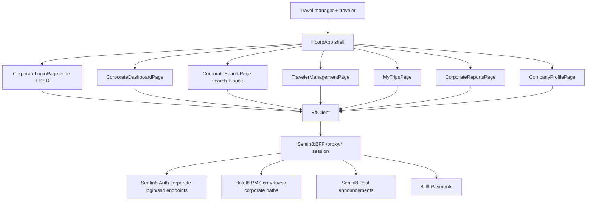

# Hotel8:eCorpBooking

## 1. Summary

Hotel8:eCorpBooking is the corporate booking portal - a Flutter web app where
business clients book negotiated corporate rates with company code verified
identity, traveler management, booking-policy enforcement, and multi-channel
payment (credit card, post-pay, bill-to-company). It is the corporate
counterpart to eBooking: leisure travelers see public rates in eBooking;
business travelers see only their company's negotiated rates here.

## 2. Motivation

Corporate travel is booked to a policy, not a price: travel managers need
rosters, cost centers, and compliance reporting; travelers need a fast,
policy-guarded booking flow. A generic public booking engine cannot express
that. eCorpBooking ties company profiles in Hotel8:PMS CRM to negotiated rate
plans, enforces travel policies at booking time, and reports savings versus
public rates - all in one surface with BFF-brokered sessions.

## 3. Architecture & High-Level Design

Seven screens over one client; `models.dart` carries the corporate aggregate
(`Company`, `CorporateRate`, `Traveler`, `CorporateBooking`, `TravelPolicy`,
company profile, report projections). Identity is company-scoped - the login
verifies a company code, and rate/booking visibility derives from the
session's company membership.

## 4. Key Traits and Data Structures

* `BffClient` - typed wrappers for corporate login/SSO/company-code
  verification, company profile + traveler roster, negotiated rate search,
  policy-managed availability, booking create/list/modify/cancel, cost
  centers, announcements read, and the four report projections.
* `Company` / `CompanyProfile` / `ApprovedProperty` / `CostCenter` - the
  company aggregate backing profile administration and policy.
* `CorporateRate` - the negotiated rate plan projection (vs public rate with
  savings), surfaced only to the company's members.
* `Traveler` + `TravelerRole` (`traveler`/`travelManager`/`admin`/
  `bookingAgent`) - the roster of who can book for whom.
* `CorporateBooking` + `CorporateBookingStatus` +
  `CorporateBookingCreate` - the booking flow, with `PaymentMethod`
  (`creditCard`/`postPay`/`billToCompany`) selection and policy context
  (`projectCode`, cost center, purpose).
* `TravelPolicy` - the corporate rule set (rate caps, advance booking,
  approved properties) enforced server-side at booking.
* Report models (`ReportSummary`, `ReportByProperty`, `ReportByTraveler`,
  `ReportByMonth`) + `Announcement` - travel-manager reporting.

## 5. Rationale, Trade-offs, and Alternatives

* **Company-scoped identity, code-verified** - company code verification at
  registration ties users to employers before rate data can appear.
  Rejected: general public sign-in (leaks negotiated rates), or full SSO-only
  (blocks smaller clients without an IdP).
* **Corporate rates fetched per company, never filtered client-side** - the
  client renders what the session can see; a company's rates never cross
  into another session's responses. Rejected: client-side filtering of the
  public rate list (one leak away from a policy violation).
* **Policy enforcement server-side; UI flags in-policy/out-of-policy** - the
  booking call enforces caps/advance-booking; the UI communicates the flags.
  Rejected: client-side blocking only (users bypass by craft).
* **Separate search path (`corporate/availability`)** - the corporate search
  returns policy context and negotiated rates only, distinct from the public
  funnel's search, keeping the two channels' data separate.
* **BFF-only egress** - uniform with all hotel8 apps.

## 6. Internal Implementation & Invariants (Private Design)

* **Invariants:**
  * All booking operations run under the company's path segment
    (`/proxy/pms/rsv/v1/companies/{companyId}/...`); no company-less booking
    paths exist in the client.
  * Rate data comes only from the negotiated-rate endpoints for the
    authenticated company.
  * Policy decisions never happen client-side; the UI highlights
    out-of-policy flags from the server response.
  * Traveler management (CRUD) and policy access are
    travel-manager/admin-scoped endpoints; the traveler role receives a
    read-only experience.
  * Non-2xx ⇒ `BffException`; models round-trip.
* Login verifies company code before credential submission when the code is
  present; SSO is attempted when the company has an IdP.
* The client is closed by the shell's dispose.

## 7. Unresolved Questions / Future Designs

* Session/corporate-SSO bootstrap (auth provider wiring) mirrors ePMS's but
  is not yet wired into the shell - login currently surfaces the proxy flow
  endpoints.
* Payment-method enablement (post-pay/bill-to-company) depends on
  credit-approval state owned by hotel sales; the UI awaits server approval
  data.
* Corporate `/admin` (branding, company codes, rate assignment, user
  approval) is a service-side RFW surface.
* Expense-integration hooks (TMS exports) are out of scope by design.

---

**Design attribution:** hotel8:ecorpbooking and its underlying concepts were designed by Hamid Jahanzad <Hamid@Jahanzad.com>.
